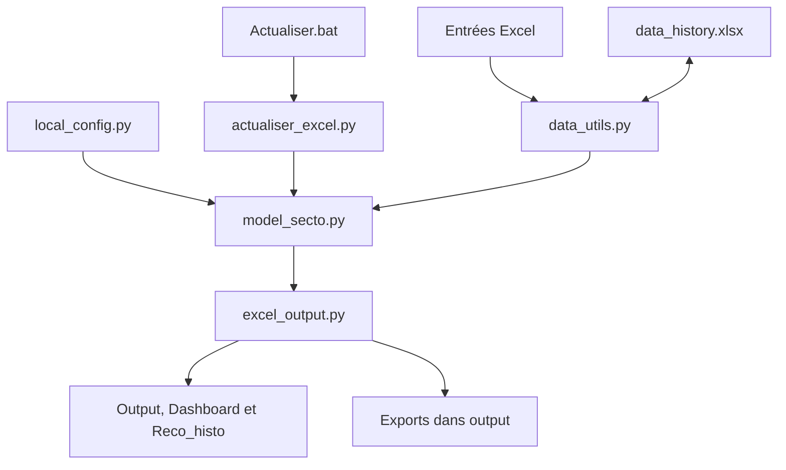

# Modèle sectoriel EU / US

Le projet calcule les scores et les recommandations EU et US à partir des données enregistrées dans Excel. La commande mensuelle est `Actualiser.bat`.

## Structure et pipeline



| Fichier | Rôle |
| --- | --- |
| local_config.py | Chemins, secteurs, variables et paramètres du modèle |
| model_secto.py | Interface SectorModel et toutes les fonctions de calcul |
| data_utils.py | Lecture des données, historique mensuel et conservation des objets Excel |
| excel_output.py | Tableaux, performances et collage des valeurs dans les modèles Excel |
| actualiser_excel.py | Sauvegarde, calcul EU et US, mise à jour Excel et bilan |
| research_secto.py et notebooks | Recherche, analyses et contrôles détaillés |

Le début de model_secto.py décrit ses six parties : interface, pipeline, sous-scores et piliers, macro et taux, rangs et recommandations, exports.

## Guide de production

Le guide pratique est [Guide_production_modele_sectoriel.docx](docs/Guide_production_modele_sectoriel.docx).

Le guide présente une synthèse opérationnelle en quatre pages et trois annexes : liens entre les fichiers Python, méthode détaillée des facteurs, agrégation des scores et benchmarks. Les adresses Excel restent dans le code.

## Production mensuelle

1. Choisir un mois terminé et conserver une copie des entrées.
2. Rafraîchir les données FactSet / Bloomberg dans Excel, puis enregistrer les valeurs.
3. Mettre à jour le fichier macro, le taux US 10 ans de Cycle macro et les poids de Bench.
4. Fermer les deux classeurs sectoriels, le fichier macro et data_history.xlsx.
5. Double-cliquer sur Actualiser.bat.
6. Lire output/actualisation.txt et contrôler Output, Dashboard et Reco_histo.
7. Conserver et diffuser la version validée.

Le lancement calcule les deux modèles et remplace les valeurs d'Output dans des copies des classeurs d'origine. Les formats, les formules du Dashboard et la disposition des graphiques sont ceux du modèle Excel et ne sont pas reconstruits par Python. Les graphiques sont rafraîchis et Reco_histo ne reçoit que les nouveaux mois. Aucun collage manuel n'est nécessaire.

La collecte fournisseur n'est pas déclenchée par ce lancement. Le programme ne filtre pas automatiquement les observations du mois en cours. Les premières observations enregistrées dans data_history.xlsx (feuille Historique_data) restent figées.

## Installation et sources

Installer les dépendances avec :

```bash
pip install -r requirements.txt
```

L'écriture des classeurs nécessite Excel pour Windows. Les fichiers source sont, par défaut, à côté du code :

- Score_Sectoriel_EU.xlsm
- Score_Sectoriel_US.xlsm
- maj cycle macro2.xlsx
- data_history.xlsx

Les chemins et les paramètres se règlent dans local_config.py. Pour un essai Python ponctuel, SectorModel accepte aussi les arguments excel_file et macro_file.

## Résultats et sauvegarde

Les deux XLSM sont mis à jour à partir de leur propre mise en page ; leurs feuilles Output, Dashboard, Reco_histo et leurs liens doivent donc être déjà préparés dans le modèle. Les exports Excel (copie de la feuille Output avec ses formats), CSV et le bilan sont dans output/. La dernière sauvegarde automatique est dans output/avant_actualisation/ ; elle ne remplace pas une archive mensuelle. Les copies de travail Excel sont créées dans le dossier temporaire du système et supprimées à la fin.

La synthèse d'Output affiche le mois du signal, les dernières données de piliers et le mois d'allocation suivant. Les scores indisponibles sont indiqués par n.a.

Le rendement du benchmark US provient de WIUSAU Index dans Returns_EQ. Le libellé historique S&P500 des graphiques a été remplacé ; les poids Bench US restent identifiés SP500_bench. Le rapport signale les rendements de benchmark manquants, les piliers qui bloquent un score Fin et la première interruption du cumul portefeuille. Si les valeurs du portefeuille existent dans Output mais pas dans le Dashboard, examiner les séries de graphique `Courbe_Ptf` et `Annee_Ptf`.

## Contenu du dépôt

Conserver le code, les notebooks sans sorties, les quatre fichiers Excel source, requirements.txt et le guide Word. data_history.xlsx fait partie des données à conserver : ses premières observations ne se reconstruisent pas à l'identique à partir de données révisées.

Le dossier output/, les caches Python, les environnements locaux et les fichiers temporaires Excel sont exclus par .gitignore. Les exports de recherche peuvent être supprimés puis recréés. Garder une archive externe des versions mensuelles validées.

Voir DOCUMENTATION.md pour l'index technique.
